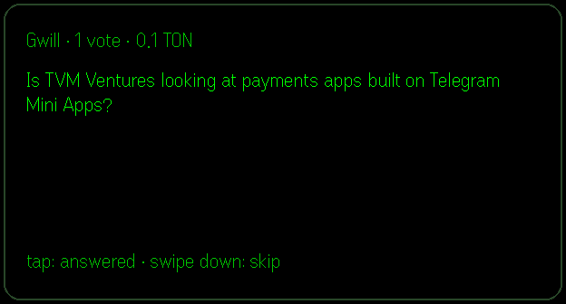
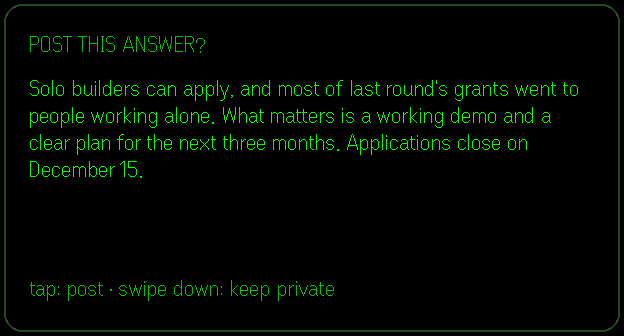
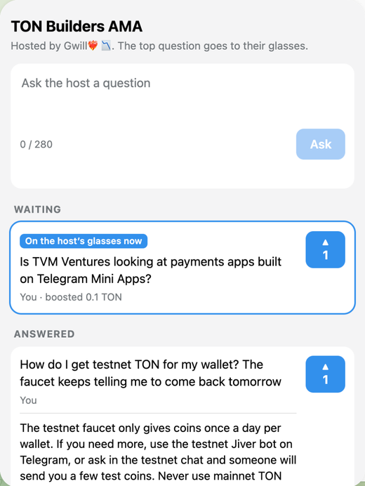
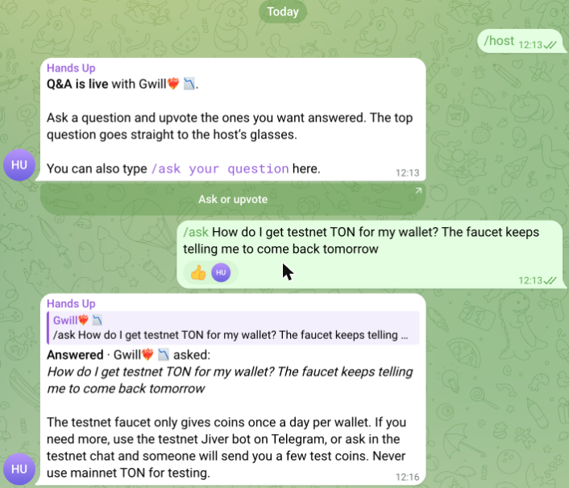
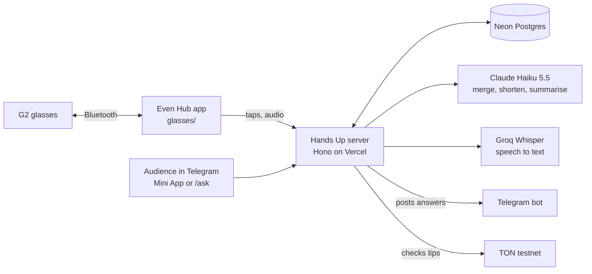

# Hands Up

**Audience Q&A on Even Realities G2, run from a Telegram group.**

The audience asks and votes in Telegram. The top question sits on the host's lens. The host answers out loud and taps once, and a short written answer goes back to the group.

<p>
  
  
</p>

- Live server: https://handsuphq.vercel.app
- Telegram bot: [@handsuphq_bot](https://t.me/handsuphq_bot)
- Demo video (2:37): https://youtu.be/2tZL25GZaHY
- Glasses package: [`handsup.ehpk` in Releases](https://github.com/big14way/handsup/releases/latest)

Built for the **Heads Up: Even Realities Hackathon** (Nov 23–29, 2026).
Tracks: **04 · AI Assistants & Work** (Claude) and **01 · Messaging & News** (Telegram).

## The problem

People who run AMAs, community calls, meetups and talks take questions from Telegram while they speak. Today that means looking down at a phone, scrolling a busy group, picking a question and losing the room. Good questions get buried, the same question is asked five times, and afterwards the people who couldn't stay have no record of what was answered.

## Who it is for

Anyone who talks to a room or a call and takes questions from a Telegram community: crypto and developer AMAs, founders at demo days, meetup speakers, and community managers running weekly calls.

## Why this is worth building

- **People already pay to manage audience questions.** Slido and Mentimeter charge about $15–25 per presenter per month ([Capterra](https://www.capterra.com/p/154051/Slido/pricing/), [Software Advice](https://www.softwareadvice.com/productivity/mentimeter-profile/)). Slido says it was used at more than 225,000 events in 2019 alone ([Slido](https://blog.slido.com/slido-2019-review/)). Mentimeter's revenue was about $38M a year in early 2024 ([Latka](https://getlatka.com/companies/mentimeter)). Both make the audience leave the chat for a separate web page, and neither works on glasses.
- **The communities are already on Telegram.** Telegram passed 1 billion monthly users in March 2025 ([TechCrunch](https://techcrunch.com/?p=2983530)), and Telegram said in June 2024 that more than 500 million people use Mini Apps every month ([Telegram](https://telegram.org/blog/mini-app-bar-paid-media-and-more)). AMA guides tell hosts to collect questions before the session because the live chat floods ([Coinbound](https://coinbound.io/how-to-host-a-crypto-ama/)).
- **Locally the need is sharper.** Nigeria has an estimated 8 million Telegram users ([Guardian Nigeria](https://guardian.ng/news/8m-nigerians-vulnerable-as-telegram-users-face-cyberattacks/)) and ranked 6th in the world for crypto adoption in 2025 ([Chainalysis via Technext](https://technext24.com/2025/09/04/crypto-nigeria-slips-india-and-u-s-lead/)). Its builder and crypto communities run their AMAs and calls in Telegram groups.
- **Glasses are growing fast, from a small base.** AI glasses shipments rose 263% year on year in the first half of 2026 ([Counterpoint via 9to5Mac](https://9to5mac.com/2026/09/21/report-ai-glasses-shipments-surged-263-in-h1-2026-as-apple-prepares-to-enter-the-market/)). Display glasses like G2 are still a small share, so Hands Up also works from the phone screen. The glasses are what make it hands-free.

## Who pays

- **Free** for groups of up to 100 people, so any community can try it in its next AMA.
- **Communities: about $15 a month, paid in Telegram Stars** (planned), for unlimited audience size, more than one host, a recap of every answer posted after the session, and question stats.
- **Tips stay with the host.** Hands Up takes no cut and never holds the money.

## How a session runs

1. The host adds [@handsuphq_bot](https://t.me/handsuphq_bot) to the group and sends `/host`. The bot posts "Q&A is live" with an **Ask or upvote** button and DMs the host a 6-digit code.
2. The host opens Hands Up on the glasses and enters the code on the phone screen. That pairs the glasses to this session.
3. The audience asks in the Mini App, or with `/ask your question` in the group, and upvotes what they want answered. Claude merges repeats into the question that is already waiting (the asker's vote goes to it) and shortens long questions so they fit the lens.
4. The lens shows only the top question: who asked it, its votes and any tips.
5. The host answers out loud. The mic is open only while a question is on the lens. Groq Whisper turns the answer into text and Claude writes it up in one or two sentences.
6. **Tap**: the lens shows "POST THIS ANSWER?" with the draft. **Tap** again to post it in the group as a reply to the original question, or **swipe down** to keep it private. The next question comes up.
7. `/end` in the group (or End session on the phone) closes the Q&A with a short closing message.

<p>
  
  
</p>

## On the glasses

The lens has three rows: a dim line of context, the one thing to read, and the gestures that act on it. Nothing else.

| Gesture | Question on the lens | Drafted answer on the lens |
|---|---|---|
| Tap | Answered: draft a summary of what you said | Post it to the group |
| Swipe down | Skip | Keep it private |
| Double-tap | Exit | Exit |

If the host doesn't really answer ("let's come back to that"), Claude returns nothing, the question is marked answered and nothing is posted. The phone screen mirrors the lens and has the same actions as buttons, plus a mic switch and End session.

**Read:** one question at a time, already merged and shortened, with who asked and how many people want it.
**Write:** the host's spoken answer becomes the written reply. No dictation and no typing: one tap to approve, one swipe to keep it private.

## TON tips (testnet)

The host sends `/wallet <testnet address>` in the group. Anyone can then tip 0.1, 0.5 or 1 TON on a waiting question from the Mini App, through TON Connect, to move it up the queue. The order is tips, then votes, then time asked.

- The money goes straight from the asker's wallet to the host's wallet. Hands Up never holds funds.
- A tip counts only after the server finds the transfer on TON testnet (through toncenter), matched by its comment `Hands Up tip #<question id>`. Each transaction can be credited once, and transfers that bounced back to the sender are ignored.
- Testnet only.

## Safety and privacy

- **No keys in the app.** The glasses app talks to one origin, `https://handsuphq.vercel.app`, which is the only entry in the packaged network whitelist. The Claude, Groq, Telegram and toncenter keys stay on the server.
- **Telegram identity is checked.** Every Mini App request carries Telegram's signed `initData`, verified with HMAC against the bot token. The webhook checks Telegram's secret token header.
- **Host access.** Only a group admin can start a Q&A. The 6-digit code is sent privately to that admin and pairs one device, once. After that the glasses use a random token. Only the host can set the tip wallet, and only the host or an admin can end the Q&A.
- **Audio is not kept.** The mic is open only while a question is on the lens. Audio is sent to Groq for transcription and is not saved by Hands Up. Only the text of the current answer is kept, and nothing is posted without the host's tap.
- **Audience text is data.** Claude's instructions treat questions and transcripts as untrusted content, never as instructions. A question that says "ignore your rules" is shortened like any other.
- **Limits.** 280 characters per question, 3 waiting questions per person, one vote per person per question.
- **Money.** Testnet only, no custody, no financial advice.

## How it is built



- `glasses/` is the Even Hub app (Vite and TypeScript, Even Hub SDK 0.0.16). It draws three text containers and rewrites only the rows that changed, so Bluetooth traffic stays small. It polls the session every 1.5 s and sends mic audio (16 kHz PCM) in 15-second chunks and right before a tap.
- `server/` is a Hono API on Vercel with a grammY bot on a webhook and Neon Postgres. The Mini App is a static page in `server/public/app/`.
- Claude (`claude-haiku-5-5`, low effort, structured output) is called twice. On intake it decides whether a question repeats one that is waiting and writes a lens-length version. On answer it decides whether the host actually answered and writes the summary. If Claude is unavailable, questions are clipped instead and nothing is posted, so the session keeps going.
- Whisper gets the question text as a prompt, so names and jargon come out spelled the way the audience wrote them.

## Run it locally

You need Node 22 or newer, a Postgres database (a free Neon project works) and a Telegram bot from @BotFather.

```sh
npm install
cp server/.env.example server/.env   # fill in the values below
npm run migrate -w server
npm run dev:server                   # http://localhost:8788
npm run dev:glasses                  # http://localhost:5173
```

| `server/.env` | What it is for |
|---|---|
| `DATABASE_URL` | Postgres connection string |
| `BOT_TOKEN` | The bot from @BotFather |
| `ANTHROPIC_API_KEY` | Claude: merging, shortening and answer summaries. Without it, questions are clipped and no answers are posted |
| `GROQ_API_KEY` | Whisper speech-to-text. Without it, Hands Up works by tap only |
| `TELEGRAM_WEBHOOK_SECRET` | Any random string, for the production webhook |
| `TONCENTER_API_KEY` | Optional. Raises the testnet rate limit |
| `DEV_AUTH` | `1` locally only: test routes and unsigned Mini App users |
| `BOT_POLLING` | `1` to run the bot by long polling on your machine. This removes the bot's webhook, so use a different bot from production |

To try it without Telegram, set `DEV_AUTH=1`, create a sample session and open it in the simulator:

```sh
curl -X POST http://localhost:8788/api/dev/seed        # prints a 6-digit host code
npx evenhub-simulator "http://localhost:5173/?code=<code>"
```

The simulator uses your computer's microphone, so you can answer out loud.

To run the packaged build against the live server instead (this is what the demo video uses):

```sh
npm run demo -w glasses      # then enter the code the bot sent you
```

## Deploy

```sh
cd server
vercel deploy --prod                                   # set the variables above in Vercel first
npm run telegram -- https://<your-app>.vercel.app      # sets the webhook and the bot's commands
```

Then in @BotFather open the bot, go to Bot Settings → Configure Mini App and set the URL to `https://<your-app>.vercel.app/app/`.

## Install on G2

Download `handsup.ehpk` from [Releases](https://github.com/big14way/handsup/releases/latest), or build it:

```sh
npm run pack -w glasses      # writes glasses/handsup.ehpk
```

The package talks to `https://handsuphq.vercel.app`. To use your own server, change the whitelist in `glasses/app.json` and build with `VITE_API_BASE=https://<your-app>.vercel.app`.

## What existed before Nov 23

Nothing from this project. All of the code was written during the hackathon, starting Nov 25 (see the commit history). It uses open-source libraries (Even Hub SDK, Hono, grammY, Vite, `@ton/core`, TON Connect UI, the Anthropic SDK) and the official Even Hub minimal template as a reference for event handling.

## Feature requests

1. **Even Hub SDK: the same events in the simulator and on G2.** The simulator sends taps on `sysEvent` and the glasses on `textEvent`, and a tap arrives with no `eventType` at all because its value is 0. Every app has to handle both shapes.
2. **Even Hub SDK: a voice-activity flag on mic audio.** Apps get raw PCM and have to send silence to a server to learn that it was silence. A speaking/not-speaking flag, or on-device transcription, would save data and battery.
3. **Even Hub SDK: emoji in the G2 font, or a published list of supported characters.** Telegram names and messages are full of emoji. On the lens they show as empty outlines, so every app has to strip them.
4. **Telegram Mini Apps: say which group a Main Mini App was opened from.** When it is opened from a `t.me/<bot>?startapp=` link posted in a group, `initData` has `chat_instance` but not the chat itself, so the app can't tell which group it belongs to. Hands Up passes the session id in `startapp` to work around it.
5. **Claude API: audio input.** A spoken answer has to go through a separate speech-to-text service before Claude can summarise it. Audio in the Messages API would make it one call.
